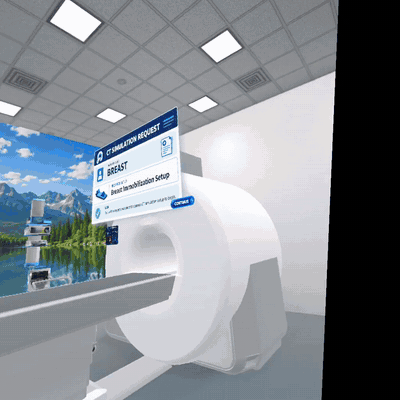
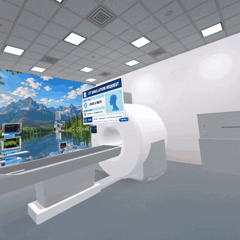

<!-- ===================== HEADER ===================== -->
<p align="center">
  
</p>

<p align="center">
  <a href="https://github.com/leenasync">
    
  </a>
</p>

<p align="center">
  
  
  
  
</p>

<p align="center">
  <a href="https://leena-alqahtani.netlify.app"></a>
  <a href="https://www.linkedin.com/in/leena-alqahtani"></a>
  <a href="https://drive.google.com/file/d/1ghwT-p61NJ2QghFOAkUASA7GJlgflSJq/view?usp=sharing"></a>
</p>

---

## 👩‍💻 About Me

I build **immersive training simulations** in **Virtual and Mixed Reality**, powered by **AI** and custom **backends**. These are experiences where people practise high-stakes, real-world skills safely before they ever do them for real.

I'm an **Information Technology** student at **Princess Nourah bint Abdulrahman University** (graduating 2027), based in **Riyadh, Saudi Arabia** 🇸🇦

```csharp
public class Leena : XRDeveloper, IAIDeveloper, IBackendDeveloper
{
    public string   Education => "B.Sc. Information Technology · PNU · 2027";
    public string[] Focus     => new[] { "VR / MR Training Simulations", "Generative AI in XR", "REST APIs & Backends" };
    public string[] Platforms => new[] { "Meta Quest 3", "OpenXR", "AR (Vuforia)" };
    public string[] Domains   => new[] { "Healthcare (Radiotherapy)", "Defense (EOD)", "Cyber Awareness", "Assistive AR" };
    public string   Currently => "Turning complex procedures into hands-on XR experiences";
}
```

- 🥽 Design and build **complete XR experiences**, from the idea through the interaction logic to the final build on headset
- 🤖 Integrate **AI** (LLM feedback, adaptive assessment) and **live sensor data from external hardware** into XR experiences
- Lead teams from concept to a **winning competition demo**

---

## 🏆 Achievements

<table>
  <tr>
    <td align="center" width="90"><h1>🥉</h1></td>
    <td>
      <b>3rd Place, Robotics Track, Defensathon 2026</b><br/>
      <sub>Organized in collaboration with the Ministry of Defense, Tuwaiq Academy and GADD.<br/>
      Team Leader & Lead XR Developer of <a href="https://github.com/leenasync/Thabat-MR-EOD-Training"><b>Thabat</b></a>, an MR bomb-disposal trainer with a live smart-glove hand-stability AI.</sub>
    </td>
  </tr>
  <tr>
    <td align="center"><h1>💡</h1></td>
    <td>
      <b>AMAD Hackathon 2026</b><br/>
      <sub>Built <a href="https://github.com/leenasync/syrax-fraud-awareness"><b>SYRAX</b></a>, an AI-powered VR fraud-awareness experience.</sub>
    </td>
  </tr>
  <tr>
    <td align="center"><h1>🎓</h1></td>
    <td>
      <b>Tuwaiq Academy, XR Development Bootcamp</b> · 120 hours<br/>
      <sub>Graduation project: <a href="https://github.com/leenasync/silent-field-vr"><b>Silent Field</b></a>, a VR landmine-awareness training experience.</sub>
    </td>
  </tr>
  <tr>
    <td align="center"><h1>🏅</h1></td>
    <td>
      <b>Dean's Recognition</b><br/>
      <sub>For extracurricular achievements.</sub>
    </td>
  </tr>
</table>

---

## 📜 Certifications

| | Certification | Issuer |
|:-:|---|---|
| 🟧 | **Amazon Junior Software Developer** · Professional Certificate | Amazon · Coursera · 2026 |
| 🟦 | **CAPM**: Certified Associate in Project Management | PMI · 2026 |
| ⬛ | **Unity VR Development** | Unity Technologies · 2025 |
| 🟪 | **XR Development Bootcamp** | Tuwaiq Academy · 2025 |
| 🟩 | **CCNA**: Introduction to Networks | Cisco · 2025 |
| 🟥 | **Java Foundations** | Oracle Academy · 2024 |

---

## 🚀 Featured Projects

<table>
  <tr>
    <td width="50%" valign="top">
      <h3>🧤 <a href="https://github.com/leenasync/Thabat-MR-EOD-Training">Thabat (ثبات)</a></h3>
      <p><b>Mixed Reality EOD Training</b> · 🏆 Defensathon 2026</p>
      <p>Trainees cut the right wires under time pressure while an <b>ESP32 smart glove</b> streams hand motion live. A <b>Hybrid Hand AI</b> scores their stability in real time and drives the gameplay, and an instructor follows along on a live dashboard.</p>
      <p>
        
        
        
        
      </p>
    </td>
    <td width="50%" valign="top">
      <h3>🩺 VR CT Simulation <sub><sup>🔒 private</sup></sub></h3>
      <p><b>Radiotherapy CT-Sim Training</b> · Client project · Meta Quest 3</p>
      <p>A full virtual CT room where students practise <b>Breast</b> and <b>Head & Neck</b> patient preparation: positioning, thermoplastic mask heating, laser alignment and marking. They then receive <b>AI-generated feedback</b> (Gemini) on their performance.</p>
      <p>
        
        
        
      </p>
      <p>🎬 <a href="#-demo--vr-ct-simulation"><b>Watch the demos ↓</b></a></p>
    </td>
  </tr>
  <tr>
    <td width="50%" valign="top">
      <h3>💣 <a href="https://github.com/leenasync/silent-field-vr">Silent Field</a></h3>
      <p><b>VR Landmine Awareness</b> · Tuwaiq Academy graduation project</p>
      <p>Gear up indoors, head out to a desert inspired by <b>AlUla</b>, locate the mine with a metal detector and defuse it step by step before the timer runs out.</p>
      <p>
        
        
        
      </p>
    </td>
    <td width="50%" valign="top">
      <h3>🛡️ <a href="https://github.com/leenasync/syrax-fraud-awareness">SYRAX</a></h3>
      <p><b>Immersive Fraud Awareness</b> · AMAD Hackathon 2026</p>
      <p>A server-driven experience that puts users inside realistic scam scenarios (a <b>phone call</b>, a <b>fake website</b> and a <b>phishing message</b>), personalized by an AI risk profile and scored on every decision.</p>
      <p>
        
        
        
      </p>
    </td>
  </tr>
</table>

<p align="center">
  ➕ Also on my portfolio: <b>AR Alzheimer's Memory Support</b>, a marker-based AR app with memory aids and cognitive exercises.<br/>
  <a href="https://leena-alqahtani.netlify.app/#work"><b>See all projects →</b></a>
</p>

---

## 🎬 Demo · VR CT Simulation

<table>
  <tr>
    <td width="50%" align="center">
      <a href="https://github.com/leenasync/leenasync/raw/main/assets/BreastCT_demo.mp4">
        
      </a>
      <br/><b>🩺 Breast Scenario</b>
      <br/><sub>Patient verification → breast board setup → positioning → skin marking → CT review → <b>AI feedback 100%</b></sub>
      <br/><a href="https://github.com/leenasync/leenasync/raw/main/assets/BreastCT_demo.mp4">▶ Watch full demo (1:11)</a>
    </td>
    <td width="50%" align="center">
      <a href="https://github.com/leenasync/leenasync/raw/main/assets/HeadNeck_CT_demo.mp4">
        
      </a>
      <br/><b>🧠 Head & Neck Scenario</b>
      <br/><sub>Patient verification → positioning → thermoplastic mask heating → mask fixation → laser alignment → <b>AI feedback</b></sub>
      <br/><a href="https://github.com/leenasync/leenasync/raw/main/assets/HeadNeck_CT_demo.mp4">▶ Watch full demo (1:21)</a>
    </td>
  </tr>
</table>

<p align="center"><sub>Previews play at 7× speed. Click to watch the full demo.</sub></p>

---

## 🛠️ Tech Stack

<p align="center">
  
</p>

<p align="center">
  
  
  
  
  
  
  
</p>

| Area | What I work with |
|------|------------------|
| 🥽 **XR** | Unity 6, OpenXR, XR Interaction Toolkit, XR Hands, Meta XR SDK, passthrough MR, Vuforia AR |
| 🤖 **AI & Backend** | Generative AI, Google Gemini API, Node.js, Express.js, REST APIs, WebSocket |
| 🧠 **Logic** | C#, Java, Python, OOP, data structures & algorithms, state machines, scoring and assessment |
| 🗄️ **Data** | SQL, MySQL, database management |
| 🎨 **3D & Scenes** | Blender, scene building, rigged characters, animation, VFX, spatial audio |

---

<h3 align="center">🤝 Let's Build Something Immersive</h3>

<p align="center">
  
</p>

<p align="center">
  <a href="https://leena-alqahtani.netlify.app"></a>
  <a href="https://www.linkedin.com/in/leena-alqahtani"></a>
</p>

<p align="center">
  
  
</p>
